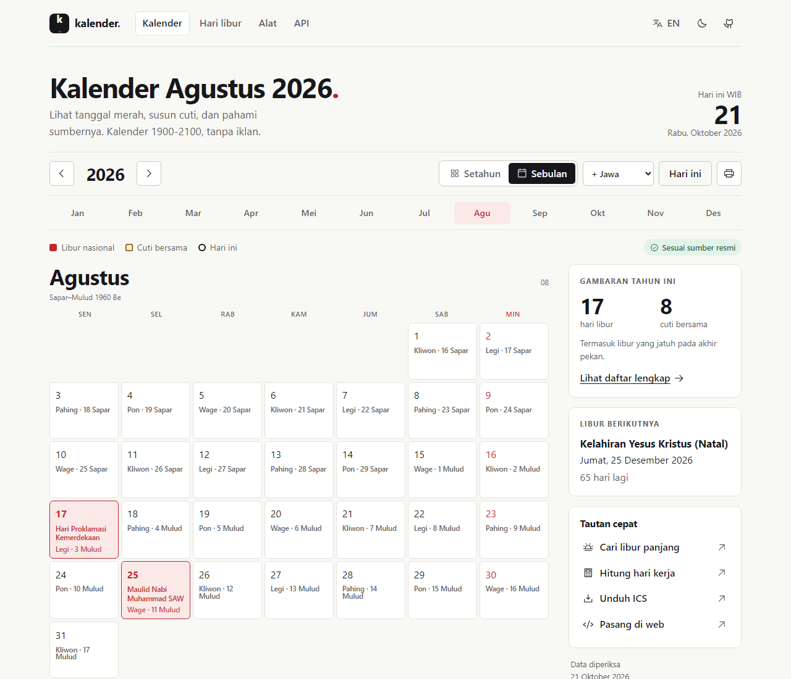
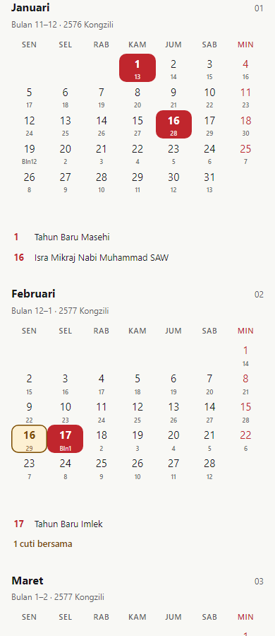

<div align="center">


# kalender.

**Cek tanggalnya. Baca sumbernya. Susun rencanamu.**

Kalender Indonesia 1900-2100 dengan libur nasional bersumber resmi, cuti bersama, kalender budaya, API, dan kalender untuk dipasang di situsmu.

[Buka kalender](https://kalender.rezaprama.com) · [English](README.md) · [Dokumentasi API](docs/API.md) · [Pasang di situsmu](#pasang-di-situsmu)

[](https://github.com/rezaprama/kalender/actions/workflows/ci.yml)
[](https://kalender.rezaprama.com/openapi.json)
[](LICENSE)

Dibuat dan dirawat oleh [Reza Prama Arviandi](https://rezaprama.com).

</div>

Cari tanggal merah. Susun cuti panjang. Cek weton. Pakai kalender ini di aplikasimu.

**Langsung pakai.** [Kalender 2026](https://kalender.rezaprama.com/2026) · [Libur 2027](https://kalender.rezaprama.com/libur?year=2027) · [Hitung hari kerja dan rencanakan cuti](https://kalender.rezaprama.com/alat)

[](https://kalender.rezaprama.com/2026/08?mode=jawa)

<details>
<summary>Lihat tampilan ponsel dengan tanggal Tionghoa</summary>



</details>

## Mulai sesuai kebutuhanmu

| Ingin… | Buka ini |
| --- | --- |
| Cek tanggal dan susun cuti | [Kalender](https://kalender.rezaprama.com) atau [alat perencanaan](https://kalender.rezaprama.com/alat) |
| Pakai aplikasi Android native | [Kalender offline, agenda pribadi, dan integrasi perangkat](android/README.id.md) |
| Tambahkan libur ke aplikasi kalender | [Unduh ICS 2026](https://kalender.rezaprama.com/api/v1/holidays?year=2026&format=ics) |
| Buat aplikasi atau spreadsheet | [Coba API](#permintaan-api-pertamamu), [baca referensi](docs/API.md), atau [unduh CSV](https://kalender.rezaprama.com/api/v1/holidays?year=2026&format=csv) |
| Pasang kalender di situs sendiri | [Salin kode embed](#pasang-di-situsmu) |
| Periksa atau koreksi tanggal | [Sumber data](docs/DATA_SOURCES.md) dan [panduan kontribusi](CONTRIBUTING.md) |
| Jalankan salinan sendiri | [Mulai secara lokal](#jalankan-secara-lokal), lalu [deploy ke Cloudflare](#deploy-salinanmu) |

## Yang bisa kamu lakukan

- Buka kalender setahun atau sebulan, pilih bahasa Indonesia atau Inggris, lihat detail tanggal, dan cetak kalender.
- Bedakan libur nasional dan cuti bersama. Setiap data resmi menautkan keputusan pemerintah atau perubahannya.
- Tampilkan tanggal Jawa, pasaran, weton, dan neptu; tanggal Hijriah; atau tanggal lunar Tionghoa bersama tanggal Masehi.
- Hitung hari kerja, cari peluang libur panjang, dan unduh data dalam format JSON, ICS, atau CSV.
- Gunakan API publik tanpa kunci, atau pasang kalender yang tingginya menyesuaikan isi.
- Baca dalam tema terang atau gelap, lewat ponsel atau desktop, dengan dukungan navigasi papan ketik.

HTML dirender di Cloudflare Workers. Tanpa framework browser, iklan, skrip pelacak, atau cookie. Metode perhitungan, ketidakpastian, dan tautan sumber ikut disertakan dalam data.

## Tanggal mana yang resmi?

**Kalender mencakup 1900-2100. Arsip libur terverifikasi saat ini mencakup 2022-2027.** Keduanya punya cakupan berbeda.

| Tahun | Status API | Data yang tersedia |
| --- | --- | --- |
| 2022-2027 | `official` | Libur nasional dan cuti bersama dari keputusan pemerintah terverifikasi, termasuk perubahan dan Keppres hari pemungutan suara |
| 2028-2100 | `estimated` | Sebagian tanggal hasil perhitungan memakai kategori Keppres 8/2024; Nyepi, Waisak, dan cuti bersama tidak ditebak |
| 1945-2021 | `unverified` | Tanggal Masehi; arsip libur belum dikurasi |
| 1900-1944 | `unverified` | Tanggal Masehi sebelum Republik Indonesia berdiri; data libur Indonesia modern tidak diterapkan |

Daftar libur kosong pada tahun yang belum diverifikasi berarti **riset belum lengkap**, bukan tidak ada libur. Tanggal Islam hasil perhitungan bisa berbeda sehari; tanggal yang menunggu isbat tetap diberi label. Tanggal Jawa setelah 2052 adalah proyeksi. Baca [metode dan rentang setiap kalender](docs/METHODOLOGY.md).

Sumber pemerintah diperiksa **setiap tiga bulan** (1 Januari, April, Juli, dan Oktober, sekitar 08.00 WIB), dan secara manual saat keputusan baru dinantikan. Temuan baru masuk ke issue peninjauan. Kurator memeriksa keputusan beserta perubahannya sebelum pull request yang lulus pemeriksaan memperbarui situs dan API. [Alur pembaruan data](docs/RELEASE.md#maintain-holiday-data).

## Permintaan API pertamamu

Tanpa pendaftaran atau API key. CORS terbuka. Periksa `status`, `missing`, dan `sources` bersama tanggal yang kamu pakai.

```bash
curl "https://kalender.rezaprama.com/api/v1/holidays?year=2026"
```

```js
const response = await fetch('https://kalender.rezaprama.com/api/v1/holidays?year=2026');
if (!response.ok) throw new Error(`Calendar API: ${response.status}`);
const { status, holidays, sources, missing } = await response.json();

console.log(status); // 'official', 'estimated', atau 'unverified'
for (const holiday of holidays) {
  console.log(holiday.date, holiday.nameLocalized, holiday.type);
}
// Cocokkan holiday.sourceId dengan sources[].id untuk menampilkan sumber.
// Periksa missing sebelum menganggap daftar libur sudah lengkap.
```

| Endpoint | Contoh | Hasil |
| --- | --- | --- |
| `/api/v1/holidays` | [`?year=2026`](https://kalender.rezaprama.com/api/v1/holidays?year=2026) | Libur, cuti bersama, status, dan sumber; JSON, ICS, atau CSV |
| `/api/v1/date` | [`?date=2026-08-17`](https://kalender.rezaprama.com/api/v1/date?date=2026-08-17) | Satu tanggal Masehi dalam kalender yang didukung |
| `/api/v1/workdays` | [`?start=2026-08-01&end=2026-08-31`](https://kalender.rezaprama.com/api/v1/workdays?start=2026-08-01&end=2026-08-31) | Jumlah hari kerja beserta cakupan data |
| `/api/v1/convert` | [`?calendar=islamic&year=1447&month=10&day=1`](https://kalender.rezaprama.com/api/v1/convert?calendar=islamic&year=1447&month=10&day=1) | Konversi tanggal Hijriah, Jawa, atau Tionghoa ke Masehi |
| `/api/v1/observances` | [`?year=2026`](https://kalender.rezaprama.com/api/v1/observances?year=2026) | Peringatan budaya dan keagamaan hasil perhitungan, terpisah dari hari libur |
| `/api/v1/calendars` | [Buka endpoint](https://kalender.rezaprama.com/api/v1/calendars) | Kalender, metode, dan rentang konversi |

[Referensi API dan respons kesalahan](docs/API.md) · [OpenAPI 3.1](https://kalender.rezaprama.com/openapi.json) · [Contoh interaktif](https://kalender.rezaprama.com/api)

## Pasang di situsmu

Tempelkan kode ini di halaman yang menerima HTML kustom:

```html
<script src="https://kalender.rezaprama.com/embed.js" defer></script>
<kalender-indonesia year="2026" lang="id" mode="jawa">
  <a href="https://rezaprama.com">Kalender oleh Reza Prama Arviandi</a>
</kalender-indonesia>
```

Ubah `year`, pakai `lang="en"` untuk bahasa Inggris, atau pilih mode kalender lain melalui [panduan embed](https://kalender.rezaprama.com/api#embed). Komponen ini membuat iframe dan menyesuaikan tingginya. Jika platformmu menghapus skrip, pakai iframe biasa dari panduan tersebut.

Pertahankan tautan kredit yang terlihat ke [Reza Prama Arviandi](https://rezaprama.com). Baca [lisensi data](LICENSE-DATA.md), terutama syarat kalender Tionghoa, sebelum penggunaan komersial.

## Jalankan secara lokal

Gunakan **Node.js 22 atau lebih baru** dan npm.

```bash
git clone https://github.com/rezaprama/kalender.git
cd kalender
npm ci
npm run hooks:install
npm run dev
```

Buka **http://localhost:8787**. Perintah dev menyiapkan data dan aset, memantau perubahan, lalu menjalankan Wrangler. Untuk pratinjau Node tanpa workerd, jalankan `npm run build`, lalu `npx tsx scripts/serve.ts`, dan buka http://localhost:8788.

| Perintah | Fungsi |
| --- | --- |
| `npm run check` | Build, pemeriksaan tipe ketat, lint Biome, validasi data, serta tes unit, integrasi, dan contoh dokumentasi |
| `npm run smoke` | Bundel Worker tanpa deploy, lalu periksa rutenya |
| `npm run e2e` | Perjalanan pengguna dan pemeriksaan aksesibilitas axe-core; pasang Chromium dengan `npx playwright install --with-deps --only-shell chromium` terlebih dahulu |
| `npm run monitor` | Periksa sumber pemerintah untuk keputusan baru; tidak mengubah data resmi |
| `npm run hooks:install` | Aktifkan pemeriksaan atribusi commit di salinan ini; CI juga memeriksa commit baru |

Lihat [struktur proyek di README Inggris](README.md#run-it-locally) untuk peta kode.

## Deploy salinanmu

Fork repositori ini dan gunakan akun Cloudflare sendiri. Sebelum deploy, ubah ID akun, nama Worker, dan rute domain di [`wrangler.jsonc`](wrangler.jsonc). URL situs dan atribusi berada di [`src/core.ts`](src/core.ts); pertahankan kredit penulis asli saat menyesuaikannya.

Hubungkan fork melalui Cloudflare Workers Builds: branch produksi `main`, perintah build `npm run build`, perintah deploy `npx wrangler deploy`, dan Preview command `npx wrangler preview`. Atau, setelah masuk dengan `npx wrangler login`, jalankan `npm run deploy` secara lokal.

Repositori ini sudah men-deploy `main` ke [kalender.rezaprama.com](https://kalender.rezaprama.com). Branch lain memakai build pratinjau Cloudflare. Baca [panduan deploy, verifikasi, dan pemeliharaan](docs/RELEASE.md) untuk alur lengkap.

## Bantu lengkapi arsipnya

Kontribusi berikutnya yang paling berguna: tahun historis beserta sumbernya, perubahan keputusan yang belum tercatat, tanggal pembanding kalender, atau perbaikan aksesibilitas. Sertakan sumber pemerintah dan jelaskan koreksinya. Mulai dari [CONTRIBUTING.md](CONTRIBUTING.md) atau [buat issue](https://github.com/rezaprama/kalender/issues/new/choose).

Kalau proyek ini berguna, beri star agar mudah ditemukan lagi. Fork, koreksi bersumber, dan contoh pemakaian membantu kalender ini berkembang.

## Lisensi dan kredit

| Bagian | Ketentuan |
| --- | --- |
| Kode sumber | [Apache-2.0](LICENSE) |
| Kurasi data orisinal | [CC BY 4.0](LICENSE-DATA.md), dengan atribusi |
| Keputusan pemerintah Indonesia | Hak dan ketentuan sumber masing-masing; lihat [lisensi data](LICENSE-DATA.md) |
| Tabel kalender Tionghoa turunan HKO | **Hanya untuk penggunaan nonkomersial**, © Pemerintah Hong Kong SAR; [syarat dan disclaimer HKO](third_party/hko/NOTICE.md). Dikecualikan dari Apache-2.0 dan CC BY 4.0 |
| Aset pihak ketiga | Lisensi masing-masing; lihat [NOTICE](NOTICE) |

Untuk situs yang memakai data atau embed, cantumkan **[Reza Prama Arviandi](https://rezaprama.com)** dengan tautan biasa. Pertahankan sumber dan pemberitahuan pihak ketiga yang diwajibkan lisensinya.
