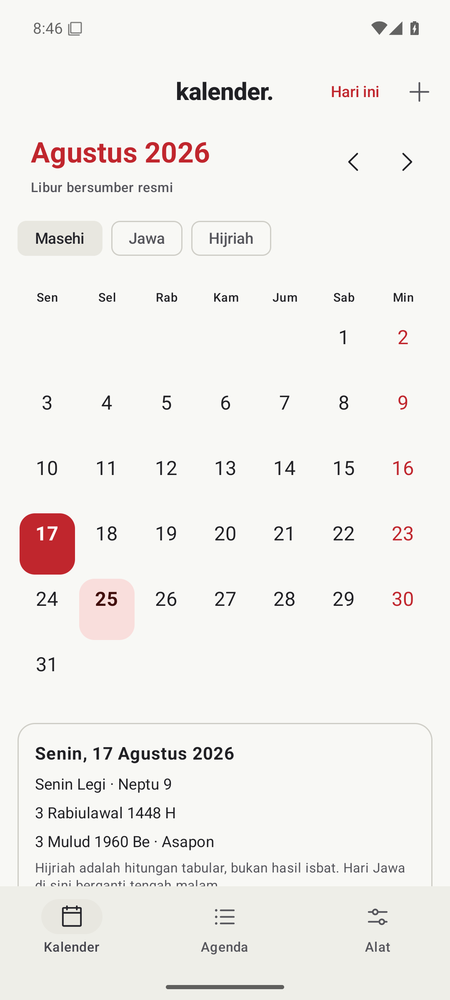
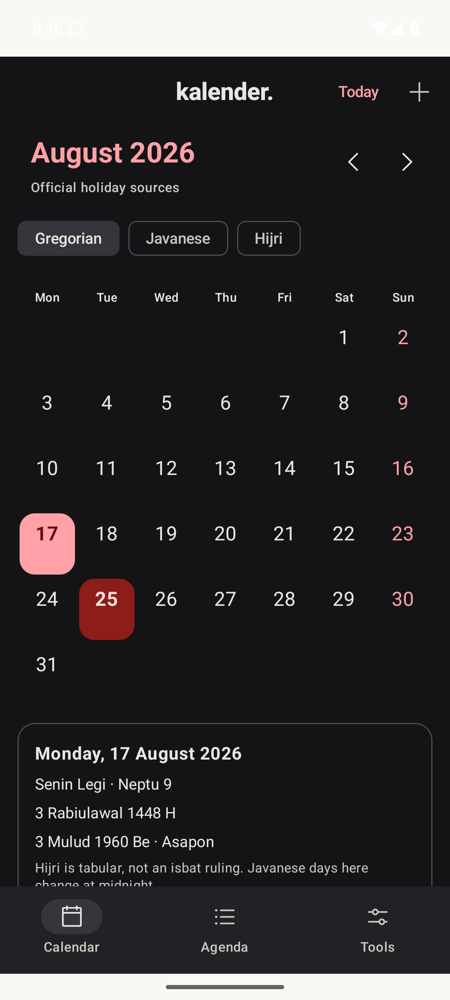
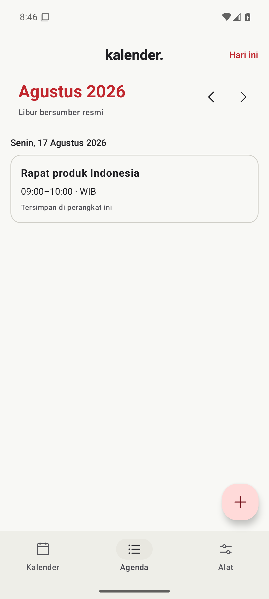

# Kalender untuk Android

Kalender Indonesia offline, agenda pribadi, dan integrasi kalender perangkat. Native Kotlin + Jetpack Compose.

**Rilis awal 0.1.0 · Android 8.0 ke atas · Indonesia dan English**

[Unduh APK Android](https://github.com/rezaprama/kalender/releases/download/android-v0.1.0/kalender-0.1.0-android.apk) · [English / panduan pengembang](README.md) · [Catatan rilis](https://github.com/rezaprama/kalender/releases/tag/android-v0.1.0)

Dibuat dan dirawat oleh [Reza Prama Arviandi](https://rezaprama.com).

Tangkapan layar aplikasi yang dijalankan di emulator. Tata letak juga diuji pada layar kecil Android 8 dan teks 130% di Android 17.

## Yang bisa dipakai

- Kalender Masehi **1900–2100**. Geser bulan, pilih tanggal, atau kembali ke hari ini.
- Libur nasional dan cuti bersama **2022–2027**, dengan tautan sumber pemerintah serta label isbat. Arsip yang belum tersedia ditandai jelas.
- Tanggal Jawa, weton, pasaran, neptu, dan Hijriah tabular. Hitungan Hijriah bukan penetapan isbat; tanggal Jawa setelah 2052 diberi label proyeksi.
- Buat, ubah, dan hapus agenda pribadi. Mendukung acara sepanjang hari, beberapa hari, serta WIB/WITA/WIT. Draf bertahan saat aktivitas Android dibuat ulang.
- Baca kalender perangkat setelah memberi izin. Kalender Google/Samsung dapat ditampilkan jika sudah tersinkron dan terlihat melalui Calendar Provider pada profil Android yang sama.
- Buka editor kalender perangkat atau bagikan ICS langsung dari formulir agenda. Keduanya memakai isian terbaru; penyimpanan lokal dilakukan lewat tombol **Simpan di perangkat**.
- Hitung hari kerja dari arsip libur terverifikasi. Pilih bahasa serta tema terang, gelap, atau mengikuti sistem.

Kalender dan agenda lokal bekerja tanpa internet. Tidak perlu akun, tanpa iklan, dan tanpa SDK analitik. Pembaruan libur mengambil data publik hanya ketika tombol **Perbarui libur** ditekan.

## Pasang dan mulai

1. Unduh APK bertanda tangan pemilik melalui tautan di atas, lalu buka lewat pemasang Android.
2. Buka kalender atau tekan **+** untuk menambahkan agenda.
3. Jika ingin melihat kalender perangkat, buka **Alat → Tampilkan kalender perangkat**, lalu tentukan izin melalui dialog Android.

ID aplikasi publik: `com.rezaprama.kalender`. Kunci tanda tangan tetap dipakai untuk pembaruan berikutnya, sehingga aplikasi tidak perlu dicopot untuk memasang pembaruan yang sah. Sidik jari sertifikat publik tersedia di [release-cert.sha256](release-cert.sha256); checksum APK ada pada rilis GitHub.

## Privasi dan batas versi

Agenda lokal tersimpan dalam basis data privat aplikasi. Cadangan otomatis dan pemindahan data otomatis Android dinonaktifkan. Akun serta isi kalender perangkat tidak diunggah ke server Kalender. Berbagi ICS atau membuka editor aplikasi lain dilakukan atas tindakan pengguna.

Izin `READ_CALENDAR` bersifat opsional. Aplikasi tidak meminta `WRITE_CALENDAR`, kontak, lokasi, notifikasi, atau alarm tepat waktu. Pembacaan kalender perangkat dibatasi 500 kejadian pertama per bulan; kejadian berulang diekspansi oleh Calendar Provider.

Versi ini belum menyediakan pengingat lokal, pengulangan agenda lokal, widget, impor ICS, atau sinkronisasi cloud sendiri. Gunakan editor kalender perangkat untuk pengingat dan layanan sinkronisasi yang sudah tersedia di perangkatmu. Integrasi langsung OAuth Google, CalDAV, dan iCloud belum disertakan.

Mencopot aplikasi menghapus agenda privatnya. Ekspor acara penting ke ICS jika ingin menyimpannya melalui aplikasi yang kompatibel. Tabel konversi Tionghoa HKO tidak dibundel dalam APK; batas data serta lisensi tetap mengikuti [LICENSE-DATA.md](../LICENSE-DATA.md).

## Pengembangan dan bukti uji

[Panduan pengembang](README.md) mencakup perintah build, struktur modul, privasi, dan batas integrasi. [Panduan rilis](RELEASE.md) menjelaskan penandatanganan lokal tanpa mengirim kunci privat ke CI.

CI menguji mesin tanggal dan ICS, Android lint, APK teroptimasi, serta alur native pada API 26/35/37.0. Bukti berupa laporan, checksum, pengukuran emulator, dan tangkapan layar tersedia di [Android Actions](https://github.com/rezaprama/kalender/actions/workflows/android.yml). Hasil emulator belum membuktikan aplikasi lebih cepat daripada kalender lain pada ponsel fisik.
